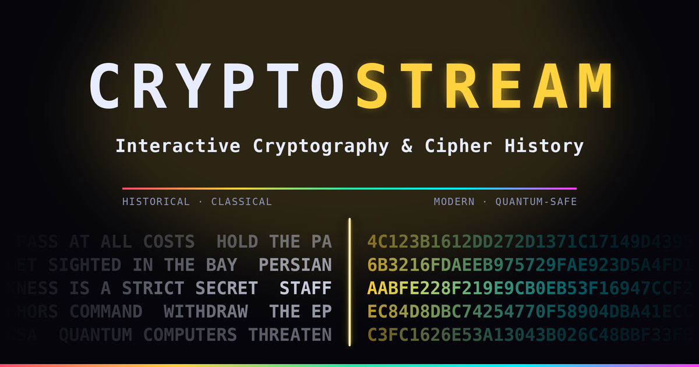

# Cryptostream
Interactive Cryptography & Cipher History

Cryptostream is an educational browser app for learning how encryption and ciphers work, from ancient historical methods to modern cryptographic systems used in everyday digital security.

It visualizes the flow of plaintext into ciphertext and explains the ideas behind substitution, transposition, block ciphers, stream ciphers, key exchange, public-key cryptography and post-quantum cryptography in a simple and interactive way.

**[🔐 Open Cryptostream](https://millaceedee.github.io/Cryptostream/)**

## What this project is

This project is designed for teaching and learning cryptography in an accessible way.

Instead of showing only formulas and abstract theory, Cryptostream helps the user see how different ciphers behave in practice:
- how Caesar and ROT13 shift letters
- how Vigenère changes the key over time
- how Enigma-like rotor systems evolve step by step
- how modern block ciphers like DES, AES and Twofish work
- how RSA, Diffie-Hellman and ECC work
- how modern stream ciphers such as ChaCha20-Poly1305 work
- how post-quantum systems like ML-KEM are designed for a future with quantum computers

The app is especially useful for:
- classroom demonstrations
- cybersecurity education
- self-study of modern cryptography fundamentals
- visual explanations of cipher history

## Features

- Interactive stream-style visualization of ciphertext and plaintext
- Historical and modern ciphers in one timeline
- Animated explanations of how each algorithm works
- En / Fi language toggle
- Cipher list and navigation between algorithms
- Security level indicators and practical notes
- Educational descriptions of strengths and weaknesses
- Works directly in the browser without a backend

## Included ciphers and algorithms

Cryptostream includes examples from:
- Atbash
- ROT13
- Skytale
- Caesar
- Vigenère
- Enigma
- DES
- Triple DES
- Blowfish
- RC4
- RSA
- Diffie-Hellman
- ECC
- AES-128 / AES-256
- Serpent
- Twofish
- ChaCha20-Poly1305
- Post-Quantum ML-KEM

## How it works

Cryptostream is built as a single-page frontend app using HTML, CSS and JavaScript. It runs entirely in the browser, so it is easy to open, share and use without installation.

The app focuses on explanation and visual intuition:
- every cipher is shown as an animated process
- the user can see a simplified model of the key flow
- the interface highlights strengths, weaknesses and practical usage
- the narrative links history, mathematics and modern digital security

## Source code

The source code is available in this repository and can be used as a basis for learning, modification or building on the project.

## About

This project is created as a teaching-oriented visualization of cryptography and cipher history.

The goal is to make cryptography easier to understand by showing how cryptographic ideas connect from ancient ciphers to modern security systems.

The project is intended for educational and curiosity-driven use.

## License

This project is licensed under the MIT License.

## Original creator

Created by **Millaceedee** in 2026.